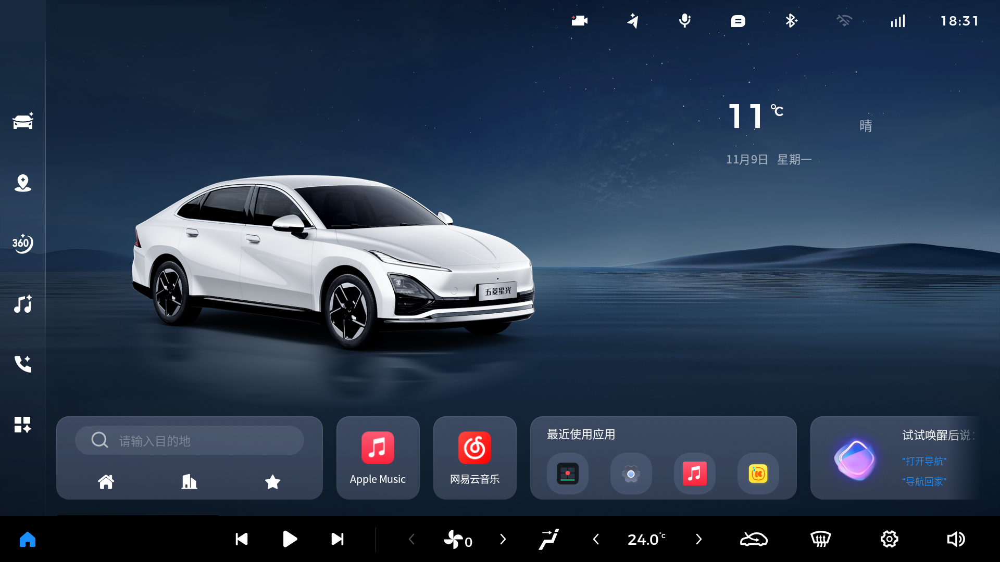
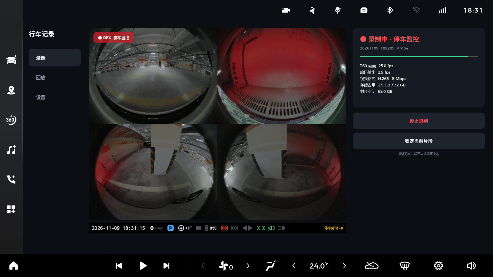
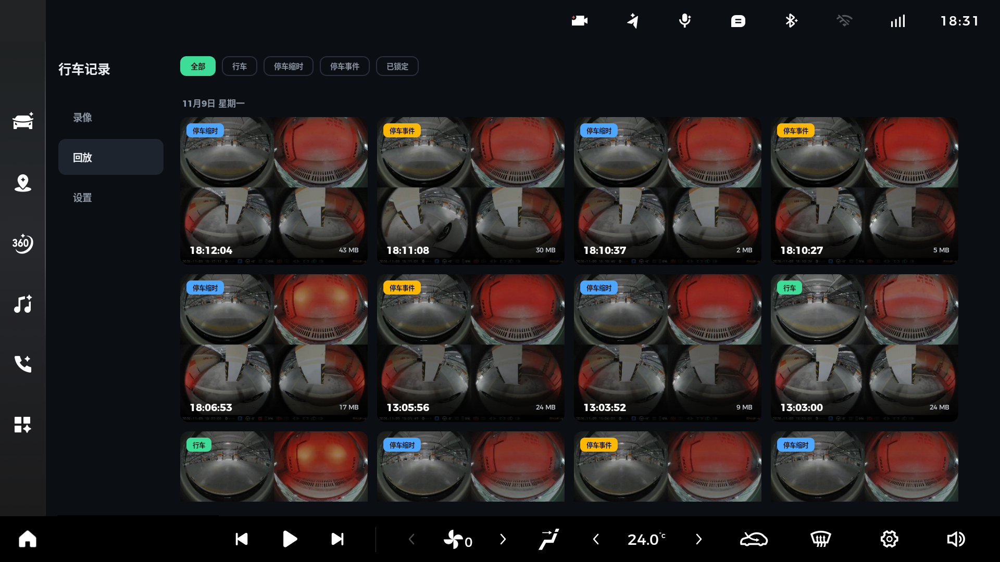
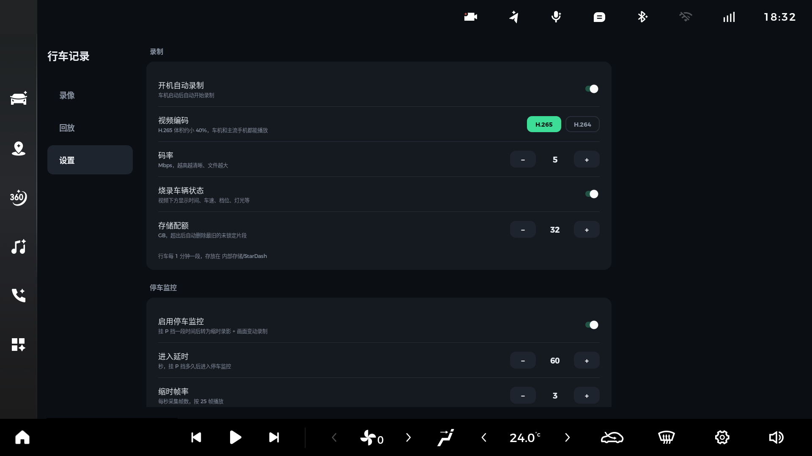

# 行车记录（StarDash）

**2025 款上汽通用五菱星光**车机的一个第三方行车记录仪 App：直接利用原车 360 全景影像的四路摄像头，在车机上持续录像，每分钟保存一段 MP4。

> [!WARNING]
> **本项目是个人开源的非官方应用，仅供测试和技术研究使用。**
> 它不是原厂功能，也不能代替经过认证的行车记录仪。录像可能因为各种原因中断或丢失，请不要把它当作唯一的事故记录手段。使用前请务必阅读文末的[免责声明](#免责声明)。

---

## 截图

**桌面**：录制时，状态栏右侧会显示摄像机图标（左上角带红点）



**录像**：实时四路预览、录制状态与存储占用，画面下方是烧录进视频的车辆状态信息栏



**回放**：按日期分组的缩略图宫格，可按行车、停车缩时、停车事件、已锁定筛选



**设置**：编码、码率、存储配额、停车监控、悬浮画面等



## 功能特点

- **四路同时录制**：前、后、左、右四个摄像头拼成一个画面录制，每段 1 分钟，按整分钟切分
- **低开销**：直接读取原车 360 系统已经输出的画面，用硬件编码器压缩，录制过程基本不占用 GPU
- **H.265 / H.264 可选**：默认 H.265，体积比 H.264 小约 40%，车机和主流手机都能直接播放
- **断电不丢录像**：录制中的文件会同时写一份索引，车机突然断电后，下次启动会自动修复，最多只丢失最后约 2 秒
- **车辆状态烧录**：画面下方单独一条信息栏，不遮挡摄像头画面，显示：
  - 日期时间、车速、档位、方向盘角度
  - 刹车、油门开度、电子手刹、AutoHold
  - 转向灯、示廓灯、近光灯、远光灯
- **停车监控**：挂 P 挡一段时间后自动转为低帧率缩时录影；检测到画面中有人或车经过时，单独录一段全帧率视频，并保留触发前约 5 秒画面
- **循环覆盖与锁定**：超出存储配额后自动删除最旧的片段，锁定的片段不会被删除
- **回放**：按日期分组的缩略图宫格，播放时自动连续播放下一段，支持 1× / 2× / 4× 倍速
- **悬浮画面**：打转向灯时弹出对应侧的后方画面；高速踩刹车时弹出后方画面
- **状态栏录像图标**：录制时在状态栏显示原车风格的摄像机图标，颜色跟随其他图标深浅变化，全屏应用中自动隐藏，点击可打开 App
- **开机自启**：车机启动后自动开始录制
- **不联网**：App 没有申请网络权限，所有录像只保存在车机本地

## 适用范围

| 项目 | 说明 |
|---|---|
| 适用车型 | **仅限 2025 款上汽通用五菱星光**，且需配备**原厂 360 全景影像** |
| 23 / 24 款星光 | ⚠️ **未经测试**，不保证可用，不建议安装 |
| 其他五菱 / 宝骏车型 | ❌ 不适用 |
| 实测车机环境 | Android Automotive 13（API 33），高通 SM6125 平台 |

> 本 App 依赖车机系统的若干内部接口（360 画面共享、车辆信号、状态栏图标资源等）。车机 OTA 升级后，这些接口**可能会被修改或移除**，导致部分或全部功能失效。升级车机系统后请重新确认 App 是否正常工作。

## 性能与体积

以下数据在一台 2025 款星光车机上实测，每项连续采样 30 秒。CPU 占用按“单个核心满载 = 100%”计算，该芯片共 8 个核心。

| 项目 | 行车模式（25 帧/秒） | 停车模式（缩时 + 画面变动检测） |
|---|---:|---:|
| App 进程 CPU | 约 40% | 约 10% |
| 硬件编码服务 CPU | 约 13% | 约 2% |
| GPU | 录制过程不使用 | 不使用 |
| 内存 | 约 26 MB | 约 26–100 MB |
| 存储写入 | 约 36 MB / 分钟 | 约 4.5 MB / 分钟 |

| 体积 | 大小 |
|---|---:|
| 安装包 | 约 77 KB |
| 安装后占用 | 约 100 KB（另有约 2 MB 的回放缩略图缓存） |
| 录像 | 默认配额 32 GB，行车约可录 15 小时，可在设置中调整 |

悬浮画面只在弹出时才渲染，期间会额外占用一些 CPU。

## 工作原理

```
原车 360 系统共享画面（4 路摄像头拼接，2560×1920，25 帧/秒）
        │  只读订阅，不发送任何摄像头或供电控制命令
        ▼
  NEON 指令隔点缩放到 1280×960 ＋ 拼接 48 像素车辆状态信息栏
        │
        ▼
  高通硬件编码器（H.265 / H.264）
        │
        ▼
  标准 MP4 封装（同时写索引，用于断电修复）→ 内部存储/StarDash
```

- 车辆状态来自车机标准的车辆属性接口（CarPropertyManager），只读取，不写入任何车辆属性
- 车机没有直接提供 AutoHold 工作状态，App 根据“D/R 挡、车速为 0、未踩刹车、刹车灯亮”推断
- 状态栏图标使用系统自带的摄像机图标资源，通过一个悬浮小窗口显示，不修改任何系统文件或系统配置

## 安装

### 准备

- 一台电脑，已安装 [Android Platform Tools](https://developer.android.com/tools/releases/platform-tools)（`adb`）
- 车机已开启 ADB 调试，并且和电脑在同一个局域网（例如电脑连上车机热点）

> 开启车机 ADB 调试的方法因车机版本而异，本项目不提供说明。

### 步骤

```bash
# 1. 无线连接车机（IP 和端口按你的实际情况替换）
adb connect <车机IP>:<端口>

# 2. 安装 App
adb install -r StarDash.apk

# 3. 授予所需权限
adb shell 'P=com.sgmwstarlight.stardash
for p in android.permission.WRITE_EXTERNAL_STORAGE android.permission.READ_EXTERNAL_STORAGE \
         android.car.permission.CAR_INFO android.car.permission.CAR_POWERTRAIN android.car.permission.CAR_SPEED; do
  pm grant $P $p
done
appops set $P SYSTEM_ALERT_WINDOW allow
appops set $P GET_USAGE_STATS allow'

# 4. 首次启动一次（激活开机自启）
adb shell am start -n com.sgmwstarlight.stardash/.MainActivity
```

各项权限的用途：

| 权限 | 用途 |
|---|---|
| 存储 | 把录像保存到 `内部存储/StarDash` |
| 车辆信息（CAR_INFO / CAR_POWERTRAIN / CAR_SPEED） | 读取车速、档位、灯光等状态，用于信息栏、停车判断和悬浮画面 |
| 悬浮窗（SYSTEM_ALERT_WINDOW） | 显示悬浮画面和状态栏录像图标 |
| 使用情况访问（GET_USAGE_STATS） | 判断当前是否在桌面，让状态栏图标颜色与其他图标保持一致 |

### 验证是否生效

```bash
adb logcat -s StarDash
```

正常情况下能看到类似日志：

```
I StarDash: start from android.intent.action.BOOT_COMPLETED
I StarDash: avm connected buffers=4
I StarDash: encoder started video/hevc 1280x1008
```

## 使用说明

App 有三个页面：

- **录像**：实时四路预览、录制状态、存储占用，可以开始 / 停止录制，或锁定当前片段
- **回放**：按日期浏览录像，可筛选行车、停车缩时、停车事件、已锁定。点击播放，长按可锁定或删除
- **设置**：编码格式、码率、存储配额、停车监控、画面变动灵敏度、悬浮画面规则等

录像保存在 `内部存储/StarDash` 下：

| 目录 | 内容 |
|---|---|
| `Drive/日期/` | 行车录像，每段 1 分钟 |
| `Parking/日期/` | 停车缩时录影，每段约 10 分钟 |
| `Event/` | 停车时画面变动触发的录像 |
| `Locked/` | 已锁定的片段，不会被自动删除 |

可以用 `adb pull` 把录像拷到电脑，或用车机自带的文件管理器导出到 U 盘。

## 已知限制

- 每个摄像头画面为 640×480，远处的车牌可能看不清
- 悬浮画面直接截取原始鱼眼画面，没有做畸变校正
- AutoHold 状态是推断得到的，极少数情况下可能与实际不一致
- 状态栏录像图标的位置是固定的，状态栏图标特别多时可能与其他图标重叠
- 如果同时安装了其他读取 360 画面的第三方应用，可能互相冲突，建议只保留一个
- 车机熄火休眠期间不录像

## 卸载

```bash
adb uninstall com.sgmwstarlight.stardash
```

卸载不会删除已经录制的视频。如需删除，请手动删除 `内部存储/StarDash` 目录。

## 自行编译

本项目没有用 Gradle，只依赖 JDK、Android SDK 命令行工具和 Zig（用于编译 C 代码）：

- JDK 17
- Android SDK Build-Tools 34.0.0
- Android SDK Platform 33
- [Zig](https://ziglang.org/download/) 0.13.0

```bash
export JAVA_HOME=$(/usr/libexec/java_home -v 17)   # macOS 示例
export ANDROID_HOME=$HOME/Library/Android/sdk
export ZIG=/path/to/zig
./build.sh
```

首次编译会自动生成签名用的 `release.keystore`，编译结果为 `StarDash.apk`。签名密码默认是 `stardashpass`，可以用环境变量 `STARDASH_KEYSTORE_PASS` 自定义。`release.keystore` 已被 `.gitignore` 排除，请不要提交到仓库。

## 项目结构

```
├── AndroidManifest.xml
├── build.sh                    编译脚本（不使用 Gradle）
├── native/dash.c               画面缩放、信息栏合成、画面变动检测、悬浮画面映射（ARM NEON）
├── res/                        App 名称与图标
├── stubs/                      车机系统接口的编译占位类，运行时使用车机自带的实现，不会打包进 App
└── src/com/sgmwstarlight/stardash/
    ├── AvmSource.java          只读订阅原车 360 共享画面
    ├── Recorder.java           取流、硬件编码、分段与停车监控状态机
    ├── Mp4Writer.java          MP4 封装与断电修复
    ├── Storage.java            录像目录、循环覆盖与锁定
    ├── VehicleState.java       车辆状态读取（只读）
    ├── InfoBar.java            车辆状态信息栏绘制
    ├── MirrorController.java   悬浮画面规则与显示
    ├── StatusIconOverlay.java  状态栏录像图标
    ├── WallpaperMode.java      读取壁纸深浅模式，让图标颜色与状态栏一致
    ├── ForegroundApp.java      判断当前前台应用
    ├── DvrStatusBar.java       向系统状态栏报告录制状态
    ├── RecorderService.java    前台服务，串联以上各部分
    ├── BootReceiver.java       开机与唤醒后自动启动
    ├── MainActivity.java       录像 / 回放 / 设置界面
    ├── PlayerActivity.java     录像播放器
    ├── Thumbs.java             回放缩略图
    ├── Config.java             设置项
    ├── Native.java             native 方法声明
    └── Ui.java                 界面样式
```

## 免责声明

**安装或使用本 App 之前，请仔细阅读以下条款。安装或使用即表示你已阅读、理解并同意全部内容。**

1. **仅供测试**：本项目只用于技术研究和测试，是**非官方**应用，**不是**原厂功能，也不能代替经过认证的行车记录仪或任何原厂安全配置。
2. **不保证录像完整**：本 App 按"现状"提供，不保证录像在任何情况下都能完整录制、保存或读取。录像可能因车机休眠、断电、存储空间不足、系统升级、程序故障等原因中断或丢失。**请不要把本 App 作为唯一的事故记录手段**，也不保证录像能在任何场合被采信。
3. **驾驶安全**：请勿在驾驶过程中操作本 App。悬浮画面仅用于辅助查看，可能存在延迟、卡顿或画面变形，**请始终以后视镜和实际路况为准**，专心驾驶。
4. **不承担责任**：车机安装本 App 后出现的**任何故障、数据丢失、功能异常、交通事故、人身伤害或财产损失**，以及由此引起的保修纠纷、法律责任，均由使用者自行承担，**作者及贡献者不承担任何责任**。
5. **隐私与法规**：录像（尤其是停车监控）可能拍摄到他人及其车辆。使用者应自行了解并遵守当地关于录音录像、个人信息保护等方面的法律法规，不得将录像用于任何违法用途。
6. **保修风险**：开启车机调试模式、安装第三方应用，可能影响车辆或车机的官方保修。请自行评估风险。
7. **非官方项目**：本项目是个人开源项目，与上汽通用五菱汽车股份有限公司及其关联公司**没有任何关联**，也未获得其授权或认可。文中提到的品牌和车型名称仅用于说明适用范围，其商标归各自权利人所有。

## 许可证

[MIT License](LICENSE)
